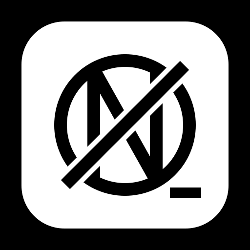

<p align="center">
  
</p>

# Nulla

Minimalist text editor for scripts and configs built with C, GTK4, and GtkSourceView 5.

## Project Structure

```
.
├── assets/
│   ├── nulla.desktop
│   ├── nulla.png
│   └── nulla.svg
├── include/
│   └── nulla.h
├── package/
│   └── arch/
│       └── PKGBUILD
├── src/
│   ├── file.c
│   ├── main.c
│   ├── settings.c
│   └── window.c
├── Makefile
└── README.md
```

## Features

- Open, edit, and save files (`Ctrl+O`, `Ctrl+S`, `Ctrl+Shift+S`, `Ctrl+N`)
- Line numbers toggle
- Light, Dark, and GTK system themes
- Syntax highlighting toggle and language selector (with auto-detection)
- Zoom control (`Ctrl++`, `Ctrl+-`, `Ctrl+0`)

## Dependencies

- `gcc`
- `make`
- `gtk4`
- `gtksourceview5`

## Build & Run

```sh
make
./nulla [file]
```

## Install

```sh
sudo make install
```

## Arch Linux Package

```sh
cd package/arch
makepkg -si
```
